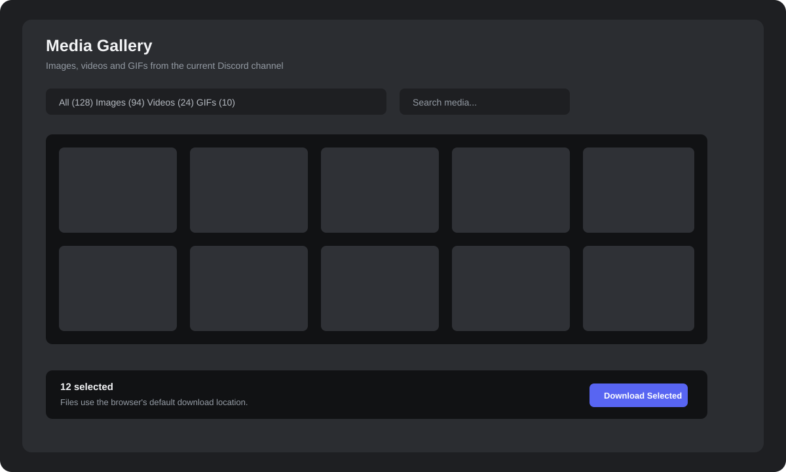
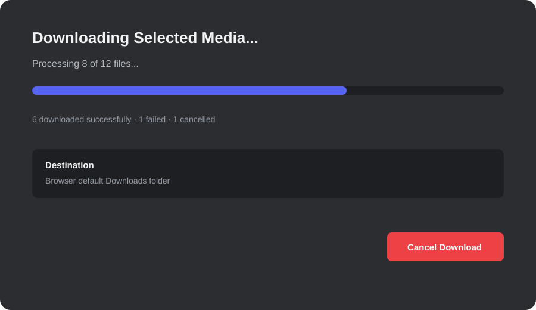

# MediaGallery (Vencord)

Browse images, videos, and GIFs from Discord channels in a responsive gallery and selectively download only the media you choose.





## Features

- Native Discord channel-header toolbar button.
- Responsive gallery for desktop, tablet, and narrow windows.
- Image, video, GIF, and GIFV support.
- Search, sorting, media-type filters, and date-range scanning.
- Select individual files or all visible results.
- Preview navigation with keyboard support.
- Message jump, URL copy, and single-item download.
- Controlled download concurrency and progress reporting.
- Explicit success, failure, cancellation, and browser-requested states.
- Retry support for failed and cancelled items.
- Lazy thumbnails, message-media caching, memoized cards, and reload-safe scanning.

## Download behavior

Files are saved using Discord/browser download settings. The browser controls the final download directory; the plugin does not access or transmit local personal files.

If the browser fallback is used, the plugin reports `Download Requested` instead of claiming that the file was written successfully.

## Supported media

- Images: JPG, JPEG, PNG, WEBP, AVIF
- Videos: MP4, WEBM, MOV, M4V
- GIF attachments and supported GIFV media

Non-media files such as PDF, ZIP, RAR, DOCX, EXE, and TXT are excluded.

## Installation for Vencord development

Copy the plugin directory into `src/userplugins/mediaGallery`, then run:

```bash
pnpm build
```

Enable `MediaGallery` in Vencord settings and reload Discord.

## Verification

Check normal channels, threads, DMs, date-range scans, large media sets, cancellation, retry, reload, and narrow window layouts.

## Privacy

Media requests are made directly through the Discord client/browser session. This plugin does not contain API keys, tokens, webhooks, personal account identifiers, or external telemetry endpoints.

## License

GPL-3.0-or-later, consistent with Vencord userplugin conventions.
