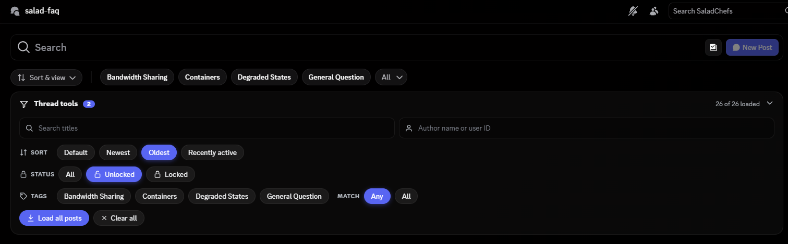

# ForumThreadTools

A [Vencord](https://github.com/Vendicated/Vencord) custom plugin that adds a local toolbar to Discord forum channels. Sort, filter and search forum posts without leaving the forum.

## Features

- Sort: default, newest, oldest, recently active (pinned posts stay on top)
- Filter by author name or user ID
- Filter by one or more tags, with Any (OR) / All (AND) matching
- Filter by status: all, unlocked, locked
- Search post titles
- All filters combine
- Load all posts button (experimental, see Limits)
- Works in list and grid view

## What it does NOT do

This is a local browsing tool only. It never sends messages, reports or moderates anyone, and never changes permissions. It only changes which posts you see on your own screen.

## Limits

- It can only filter posts Discord has loaded. Use Load all posts or scroll to load more. It does not search the full history.
- Author names only match users Discord has cached locally. User IDs always work.
- Load all posts relies on a patch that may not apply on every Discord build. If the counter does not climb, scroll manually. The rest of the plugin still works.
- The plugin patches Discord's minified code, so it can break whenever Discord updates. If the toolbar disappears, open the console (Ctrl+Shift+I), filter for ForumThreadTools and look for a patch errored line.

## Installation

Vencord does not support installing custom plugins from inside the app, so you need to build it from source. Official guide: https://docs.vencord.dev/installing/custom-plugins/

1. Install Git, Node.js and pnpm.
2. Run: git clone https://github.com/Vendicated/Vencord
3. Run: cd Vencord
4. Run: pnpm install --frozen-lockfile
5. Run: git clone https://github.com/Desixred-byte/ForumThreadTools src/userplugins/forumThreadTools
6. Run: pnpm build
7. Run: pnpm inject
8. Restart Discord, open Settings, Vencord, Plugins, and enable ForumThreadTools.

## License

GPL-3.0-or-later, the same as Vencord.
